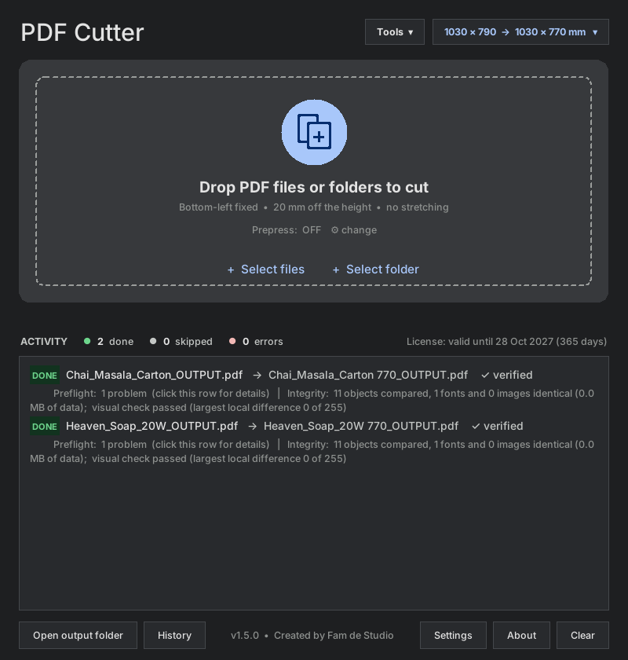
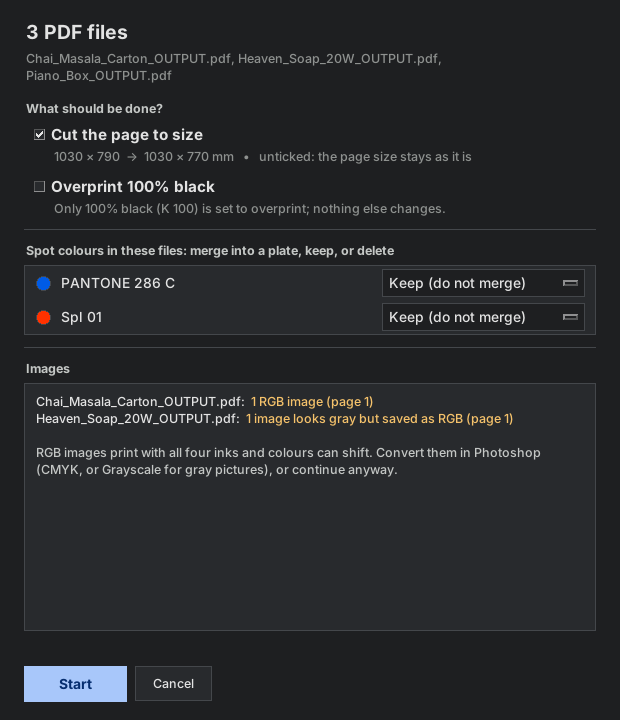
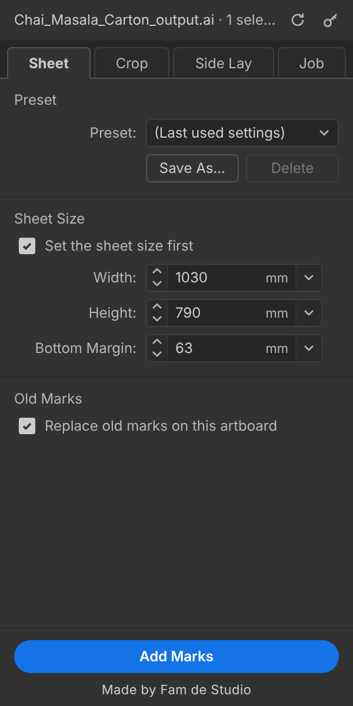
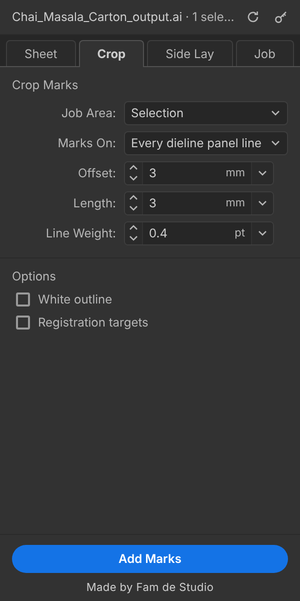
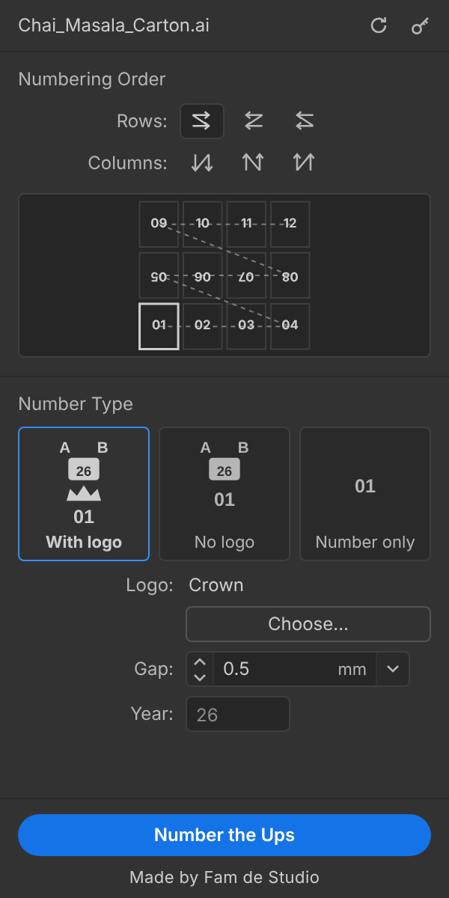
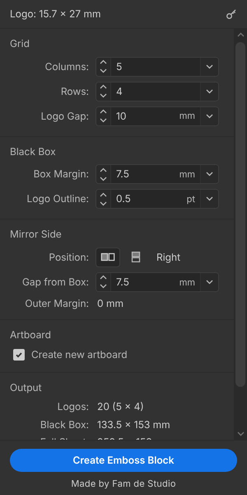
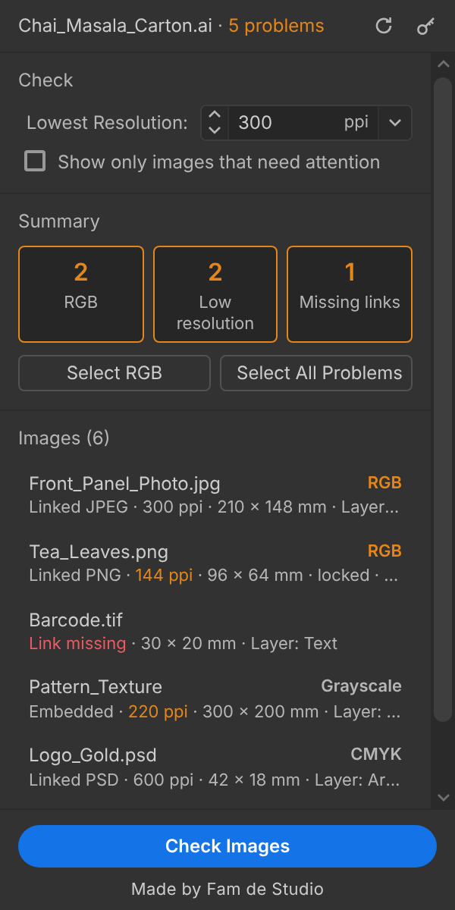
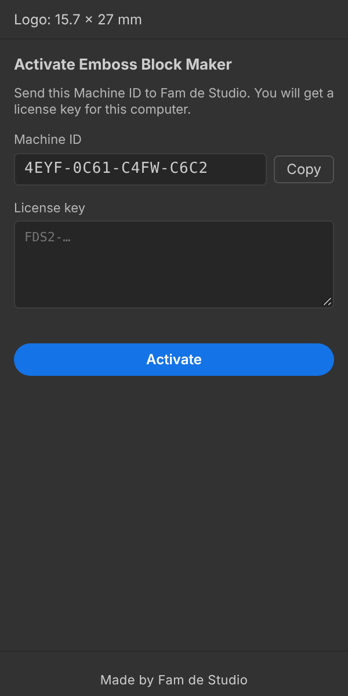

# Fam de Studio Tools

**Professional prepress tools for printing and packaging, by Fam de Studio.**

Save hours of repetitive work on every job: plate-ready PDFs, printer marks, ups numbering, emboss blocks and image checks, done in seconds and done the same way every time.

| Product | Type | What it does |
|---|---|---|
| **PDF Cutter** | Windows app | Cuts print-ready PDFs to plate size, merges spot colours, sets black overprint, checks every file |
| **Print Marks** | Adobe Illustrator plugin | Crop marks, side lay, gray scale, job slug and ink boxes on the press sheet |
| **Ups Number** | Adobe Illustrator plugin, included with Print Marks | Numbers every up on the sheet from one 01, with the shift / year mark |
| **Emboss Block Maker** | Adobe Illustrator plugin | Builds a complete emboss block sheet from any logo or text in one click |
| **Image Check** | Adobe Illustrator plugin | Finds every RGB image, low resolution image and missing link in the file, linked or embedded |

**Try any product free for 7 days.** One installer, pick only what you need.

---

## PDF Cutter

 

Drop PDF files or a whole folder. PDF Cutter asks what to do: **cut the page**, **overprint 100% black**, and for **every spot colour found in the files** which plate it goes into (Black, Cyan, Magenta, Yellow), keep it, or **delete** it. It also warns about RGB images before it starts:

- Cuts the page to plate size (for example 1030 × 790 → 1030 × 770 mm): bottom-left stays fixed, nothing is stretched. Or keeps the page size and only does the overprint / spot merge.
- Merges spot colours (such as "Spl 01") into the plate you choose for each one, or deletes a spot colour you do not want (it disappears completely and leaves the artwork under it as it is). Sets 100% black to overprint. Your last choice for each spot is remembered.
- **Every file is verified** before it is saved: an object-by-object integrity check and a visual comparison. If anything looks wrong, nothing is written. Your original file is never changed.
- **RGB image warning:** every image is checked. Real grayscale images are never reported; a picture that looks gray but is saved as RGB is pointed out separately, because it would print with all four inks.
- Preflight report: fonts, image resolution, RGB images, thin lines, total ink, spot colours and artwork in the cut-away area.
- Images are never changed: they stay exactly as they are in your file.
- Before / after preview, history, presets with automatic detection, batch processing in the background.

## Print Marks

Select the dieline and click **Add Marks**. Everything a press sheet needs, in your house style:

- **Sheet:** sets the sheet size (e.g. 1030 × 790 mm) and positions the job; save your own presets; replaces old marks.
- **Crop:** crop marks on every corner and crease line of the die, with offset, length and line weight; optional registration targets.
- **Side Lay:** a side lay scale for every ink, gray scale, sheet center line and corner square.
- **Job:** job name, job number, client, date and ink boxes on the slug.

## Ups Number

Its own panel, **included with Print Marks** (the same licence key opens both). Type **01** in one up, select it and click **Number the Ups**:

- Every up on the sheet gets its number: 01, 02, 03 ... in the order you choose (6 directions along rows or columns).
- Works on joined ups too, including turned and mirrored ups; numbers are turned with their up.
- Three number types: **with logo** (the shift letters A B, the year and a logo above each number), **no logo** (A B and the year only), or **number only**.
- **Your own company logo:** click **Choose…** and pick your logo (AI, PDF, EPS, SVG, PNG, JPG or TIF). It is fitted under the year box automatically. A crown logo is built in.
- The mark is placed above each number with the gap you set; the year is filled in for you.
- A sheet map in the panel shows the order before you run it.

 

## Emboss Block Maker

Select a logo or text in Illustrator and click **Create Emboss Block**.

- **Negative block:** a solid black box with your logos in white, each with a fine 0.5 pt outline, ready for the emboss block maker.
- **Mirrored positive:** the same grid mirrored, in solid black.
- Choose the grid (default 5 × 4 = 20 logos), the gap between logos, the box margin and the outline weight.
- Text is outlined automatically, overlapping shapes are joined, and a new artboard is created to fit.
- The panel shows the final block and sheet size before you create it.

 

## Image Check

Open the panel and every image in the file is checked at once, before the file goes to the plate:

- **RGB images:** finds every RGB, indexed (PNG / GIF) and Lab image. **Linked images too:** Image Check reads the linked JPEG, PNG, TIFF, PSD / PSB, GIF or BMP file itself, so nothing slips through.
- **Low resolution:** the real resolution of each image as it sits on the page (scaled or rotated), against your own limit (default 300 ppi).
- **Missing links:** linked files that cannot be found.
- Finds images inside groups and clipping masks, and on locked or hidden layers.
- Click an image in the list to select it and show it, or select every RGB image (or every problem) in one click.
- Checks again by itself when you switch files or place new images.

 

---

## Plans and pricing

| | Monthly | Yearly | Lifetime |
|---|---:|---:|---:|
| **PDF Cutter** | PKR 2,500 | PKR 20,000 | PKR 40,000 |
| **Print Marks** (with Ups Number) | PKR 3,000 | PKR 25,000 | PKR 50,000 |
| **Emboss Block Maker** | PKR 1,500 | PKR 12,000 | PKR 25,000 |
| **Image Check** | PKR 1,000 | PKR 8,000 | PKR 15,000 |
| **Full Package (all four)** | **PKR 5,500** | **PKR 45,000** | **PKR 90,000** |

- **Yearly plans** cost about 3 months less than paying monthly.
- **Full Package** saves about 30% compared with buying the products one by one.
- **Second computer** in the same company: half price.
- **Site licence** (every computer in your company): 3 × the yearly price.
- **Outside Pakistan:** PDF Cutter $15 / month or $129 / year · Print Marks $19 / $159 · Emboss Block Maker $9 / $79 · Image Check $6 / $49 · **Full Package $35 / month or $299 / year**.

## Free 7-day trial

Every product can be tried **free for 7 days with all features**, without payment:

1. Install the products you want to try (see below).
2. Open the product. It shows your computer's **Machine ID** (for example `7K2M-QX9D-4HTP-0ZRB`).
3. Send the Machine ID to Fam de Studio and ask for a trial.
4. Paste the trial key you receive and click **Activate**.

When you buy, you receive a new key for the same computer, so nothing needs to be reinstalled. Your settings and presets stay.

## How licensing works

- Each product has its own licence key, made for **your computer**.
- Activation works **offline**: no account, no internet connection needed.
- A reminder appears 5 days before a monthly or yearly licence ends; renewing only means pasting a new key.
- Moving to a new computer: send the new Machine ID and you get a key for it.

 

## Installation

**Requirements:** Windows 10 or 11 (64-bit). Illustrator plugins: Adobe Illustrator 2021 or newer (tested with Illustrator 2025).

1. Close Adobe Illustrator and PDF Cutter.
2. Run **`FamDeStudioTools_Setup_<version>.exe`**.
3. Tick the products you want: one, some or all of them.
4. Open them:
   - Illustrator plugins: **Window > Extensions (Legacy) > Print Marks / Ups Number / Emboss Block Maker / Image Check**
   - PDF Cutter: **Start menu > Fam de Studio > PDF Cutter**

Updates install over the old version; licences, presets and settings are kept. To remove: **Windows Settings > Apps > Fam de Studio Tools > Uninstall**.

---

**Fam de Studio** · Made for printers and packaging studios, tested on real production jobs.

© 2026 Fam de Studio. All rights reserved.
